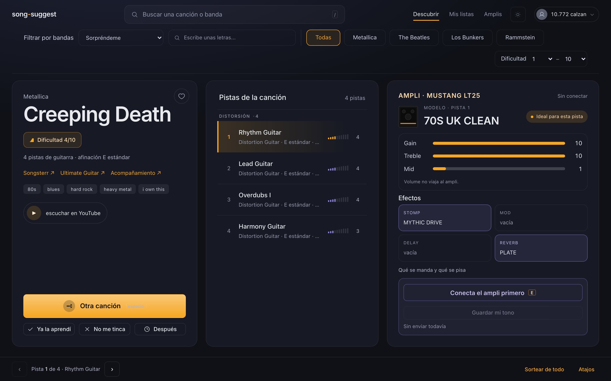
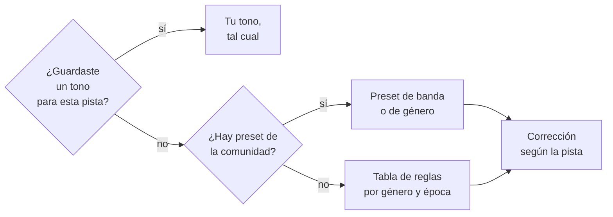
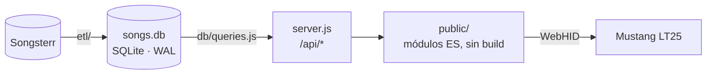

# song-suggest

**El tono de la canción, del navegador al ampli en un clic.**

Lo armé para resolver un problema mío. Tenía los tonos de las bandas que me
gustan en planillas que la comunidad del **Fender Mustang LT25** comparte en
internet, pero pasar cada uno al amplificador era engorroso y lento: a mano,
efecto por efecto y perilla por perilla, cada vez que cambiaba de canción.
Quería elegir la canción y que el ampli quedara listo.

Eso es `song-suggest`: las planillas ya vienen importadas, el tono se ajusta a
la pista que vas a tocar (rítmica, solo, intro limpia o acústica) y se manda al
LT25 por USB directo desde el navegador, con las cinco ranuras de efectos de una
vez.

Las recomendaciones llegaron después, casi de rebote. Teniendo ya el catálogo
de Songsterr cargado para buscar los tonos, en algún momento dejé de saber muy
bien qué tocar, así que le sumé un sorteo con filtros simples que no vuelve a
ofrecerte lo que ya aprendiste o descartaste.



<sub>*Creeping Death*, abierta desde el buscador. A la derecha, el tono para la
pista elegida (el preset de Metallica de la planilla) listo para mandar; al
centro, sus cuatro guitarras, cada una con su propio tono.</sub>

| | Antes | Con `song-suggest` |
|---|---|---|
| **Encontrar el tono** | Buscar la banda en una planilla | Viene en la tarjeta, para cada pista |
| **Pasarlo al ampli** | A mano, efecto por efecto y perilla por perilla | Un botón (o la tecla `E`): las cinco ranuras de una vez |
| **Elegir qué tocar** | Recorrer tablaturas sin criterio | Un sorteo con filtros, que respeta lo que ya sabes |

```
npm run etl     # una vez: baja y enriquece el catálogo
npm start       # http://localhost:3000
```

> Cero dependencias de npm: `node:sqlite`, `node:http` y `node:test`, todo
> incluido en Node. Requiere **Node ≥ 24**. Sin paso de build.

## Qué hace

| | Qué | Lo que lo hace distinto |
|---|---|---|
| 🔌 | **Lo manda al ampli** | Las cinco ranuras por WebHID. Ninguna escritura se da por buena sin el ACK del equipo. |
| 🔊 | **Propone el tono** | Presets de la comunidad del LT25 por banda y género, corregidos según la pista: limpia, acústica o con distorsión. |
| 🎚️ | **Pista por pista** | Una canción trae hasta 11 guitarras. Cada una tiene su dificultad, su afinación y su tono. |
| 🎛️ | **Edita el ampli entero** | Las cinco ranuras con todas sus perillas, en vivo, y guardado en ranura con doble confirmación. |
| 🧠 | **Aprende de tu oído** | Guarda el tono que dialaste y anota cómo sonó el propuesto. Con eso se puntúa cualquier cambio al sugeridor. |
| 🎲 | **Sortea qué aprender** | Filtros de modo, dificultad y bandas que miran **cada pista** de guitarra, no sólo la más tocada. |
| 🔎 | **Busca por nombre** | `metallica fade` abre la tarjeta directo, sin gastar el sorteo. |
| 📚 | **Lleva tu historial** | Aprendidas, *no me tinca*, *después* y me gusta. Nada de eso se vuelve a sortear. |

## En cifras

Medido sobre el `songs.db` real el 2026-10-10.

| | |
|---|---:|
| Canciones en el catálogo | 20.013 |
| Ya enriquecidas por el ETL | 12.727 |
| Sorteables hoy (sin basura, sin descartadas) | 10.772 |
| …de ellas, con más de una pista de guitarra | 8.617 |
| Pistas de guitarra con tono propio | 29.988 |
| Bandas (escrituras agrupadas) | 2.612 |
| Presets de la comunidad importados (77 de banda + 10 de tono) | 87 |
| Unidades del LT25 en el catálogo del editor | 48 |
| Tests en `npm test` | 425 |

## Puesta en marcha

| Paso | Comando | Nota |
|---|---|---|
| 1. Catálogo | `npm run etl` | 2-3 horas la primera vez. Reanudable: Ctrl-C cuando quieras. |
| 2. Servidor | `npm start` | Usable tras las primeras ~300 canciones enriquecidas. |
| 3. Ampli *(opcional)* | — | Chrome o Edge, LT25 por USB, Fender Tone LT Desktop cerrado. |

`npm start` y `npm run etl` pueden convivir sobre el mismo `songs.db` sin
pisarse (usa WAL), así que puedes usar la app mientras el catálogo termina de
bajar.

<details>
<summary><b>Banderas del ETL</b></summary>

`npm run etl -- <banderas>`

| Bandera | Para qué sirve |
|---|---|
| `--limit N` | Enriquece como máximo N canciones pendientes. Útil para una prueba rápida. |
| `--concurrency N` | Cuántas descargas de metadata corren en paralelo (por defecto 3). |
| `--solo-catalogo` | Sólo baja el catálogo (fase 1); no enriquece nada. |
| `--solo-meta` | Salta la fase 1; sólo enriquece lo que ya está en la base. |
| `--re-enriquecer` | Antes de la fase 2, marca todas las canciones para volver a enriquecerse (borra `enriched_at`, no toca `song_state`). Úsala para refrescar tags, vistas y banderas de calidad tras un tiempo. El catálogo (artista, título, tracks) ya se actualiza solo en cada corrida. |

`N` en `--limit` y `--concurrency` tiene que ser un entero mayor que 0: un
typo (`--limit abc`, `--limit -5`) aborta con un mensaje en vez de disparar
una corrida completa por accidente.

</details>

> [!IMPORTANT]
> **Respalda `songs.db`.** Todo se reconstruye con el ETL salvo tres tablas:
> `song_state` (aprendidas, descartadas, me gusta), `user_tone` (los tonos que
> dialaste) y `tone_judgment` (tus juicios). Ver [Respaldo](#respaldo).

---

## El amplificador

### De dónde sale el tono



Los presets salen de una planilla que mantiene la **comunidad de usuarios
del Mustang LT25**
([enlace](https://docs.google.com/spreadsheets/d/1KWvjJ6q6Ora2MqmxtUAWjq9Uerp0Ycza5ouuKuol5HQ/edit?gid=1647190216)):
los ajustes que a esas personas les funcionaron para esa banda o ese tono.
**Es opinión de esa comunidad, no una medición de la grabación**, y la
tarjeta lo dice junto a cada sugerencia, incluida la incertidumbre que la
planilla marcó en algunas filas. Qué se citó y con qué límites:
`data/PROCEDENCIA.md`. Qué entró, fila por fila:
`docs/presets-comunidad-auditoria.md`.

**El preset es de la banda, pero el tono es de la pista.** Antes de mandarlo
se corrige según qué toca esa guitarra. Sobre las 29.988 pistas, medido el
2026-10-10:

| La pista es… | Qué pasa | Ejemplo | Pistas |
|---|---|---|---:|
| **Acústica** | Se ignora el preset de banda y decide la tabla de reglas. | La acústica de Metallica: un CHAMPION limpio. | 3.220 |
| **Eléctrica limpia** | Conserva el ampli de la banda, con ganancia ≤ 3 y sin pedal de drive. Un compresor o un EQ se quedan. | El interludio de *Master Of Puppets* salía con 70S UK CLEAN a 10 y un MYTHIC DRIVE. | 1.346 |
| **Con distorsión** y la tabla le dio un ampli limpio | Piso de ganancia y un OVERDRIVE en `stomp`. **El modelo no cambia.** | La lead de *Comfortably Numb* salía con 60S UK CLEAN a 4. | 1.081 |

La tarjeta dice en cada pista por qué se le corrigió el tono.

<details>
<summary><b>Por qué estas correcciones y no otras</b></summary>

- **Limpia:** sigue siendo la misma guitarra, sólo sobra la saturación. El
  drive se quita por lista (`STOMPS_DE_DRIVE`), no vaciando la ranura: el
  stomp más usado de la planilla es el COMPRESSOR, y en una pista limpia está
  bien puesto.
- **Distorsión:** subir la ganancia sin cambiar el ampli no es opinión nuestra.
  14 presets de la planilla usan un ampli de voz limpia con ganancia alta y 11
  lo acompañan de un pedal: Hendrix es un 60S UK CLEAN a 6,5 con FUZZ. Sólo se
  corrige lo que viene de la tabla de reglas; si la contradicción viene de un
  preset de la comunidad no se toca, porque ahí alguien eligió esa
  combinación a propósito.
- **`Electric Guitar (jazz)`:** Songsterr usa esa etiqueta como patch de MIDI,
  no como intención. Cuenta como limpia salvo que el nombre de la pista diga
  que es una lead. Así las leads de Kirk Hammett en *Blackened 2020*
  conservan su distorsión.

</details>

### Enviarlo por USB

El navegador le habla al LT25 directo por **WebHID**, sin intermediarios.

| Requisito | Por qué |
|---|---|
| **Chrome o Edge** | WebHID no existe en Firefox ni en Safari. Ahí los ajustes se ven, pero las perillas van a mano. |
| **Fender Tone LT Desktop cerrado** | El ampli acepta un solo cliente a la vez. |
| Conectar con el botón del encabezado | El permiso queda recordado: la próxima vez reconecta solo. |

**Qué viaja en cada envío:**

| | |
|---|---|
| ✅ **Las cinco ranuras** | `stomp`, `mod`, `amp`, `delay` y `reverb`. Las que la pista usa cargan su unidad; las que no, **quedan vacías**. |
| ✅ **El modelo de ampli** | Reemplaza la unidad de `amp` por la que sugiere la pista, si la declara. |
| ✅ **`gain`, `treb`, `bass`** | Y `mid` cuando el preset lo declara. Con los nombres del equipo. |
| ❌ **El volumen** | Se lee antes de cambiar de modelo y se devuelve tal cual. El equipo lo recibe en dB: mandar 0.4 como "4 de 10" puede ser un salto brutal. |
| ❌ **Perillas sin curva conocida** | Quedan en el valor por defecto de la unidad, que es dato real del equipo. Si esa unidad la cargó este envío, se avisa **en rojo**. |
| ❌ **Nada se graba** | Todo va al preset activo, en memoria. Reseleccionarlo en la rueda deja el ampli como estaba. |

> [!WARNING]
> Vaciar las ranuras que la pista no usa **borra lo que hayas dialado a mano
> ahí**. Si dejas puesto un slapback para surf y después sorteas thrash, ese
> slapback no sobrevive. Es a propósito: un tono a medias entre dos canciones
> no es el tono de ninguna.

El ampli ignora en silencio lo que no entiende, así que **cada perilla espera
el ACK del equipo**. Si no llega en 2 segundos se reporta `sin confirmar` en
vez de darse por aplicada. Si lo ves, vuelve a pulsar el botón.

### Tu tono y tu juicio

Dos cosas aparecen junto al envío, y son las que hacen que el sugeridor
pueda mejorar con datos y no con opiniones:

| | Qué hace |
|---|---|
| **Guardar mi tono** | Relee lo que el ampli **tiene** (no lo que se le mandó) y lo guarda para esa pista. Desde entonces esa pista sale con tu tono, por encima de cualquier sugerencia. |
| **¿Cómo sonó?** | Después de un envío exitoso: *Bien*, *Muy sucio*, *Muy limpio*, o qué sobra o falta de modulación, delay o reverb. Se anota junto con la cadena que estaba sonando. |

Si el ETL reordena las pistas de una canción, un tono guardado que ya no
calza con su pista **no se aplica**: se cae a la sugerencia normal.

`npm run tono:evaluar` puntúa el sugeridor contra esos juicios y tonos
guardados. No demuestra que un tono suene como el disco: demuestra que
coincide más con lo que tú aprobaste.

### El editor

El botón **Amplis** (visible si el navegador soporta WebHID) lee el preset
activo y dibuja las cinco ranuras con su unidad y todas sus perillas,
incluidos el volumen y el modelo. Todo se escribe en vivo: si el equipo no
confirma, el control vuelve al último valor confirmado y lo dice.

<details>
<summary><b>Cómo convive con el resto</b></summary>

- Mientras lee, cambia una unidad o guarda, sus controles se deshabilitan.
- Si mandas los ajustes de una canción con el editor a mitad de una lectura
  (o al revés), no se pisan: las operaciones hacen cola.
- Girar la rueda del equipo sigue siendo el modo de deshacer: recarga el
  preset y descarta lo escrito encima. El editor no se entera solo; usa
  **Releer del ampli** para sincronizar.

</details>

> [!CAUTION]
> **Guardar en el ampli** es la única operación irreversible del proyecto:
> graba en una ranura del equipo y pisa lo que hubiera. Por eso el diálogo te
> obliga a mirar antes:
>
> 1. La ranura de destino **no viene puesta**: la escribes tú.
> 2. La app lee esa ranura y te dice qué preset hay ahí ahora.
> 3. Lee también el preset activo y te dice con qué se va a pisar, incluida
>    su ranura y si está editado sin guardar.
> 4. Confirmar no se habilita hasta que vuelvan las dos lecturas, y justo antes
>    de grabar se relee el preset activo: si cambió, no se guarda.
>
> Si alguna lectura falla, no se guarda nada.

---

## Sortear

La barra de filtros junta el **modo**, el buscador de **bandas** con sus
pastillas rápidas y el rango de **dificultad**. Abajo, un contador dice
cuántas canciones calzan con la combinación completa.

| Modo | Qué exige de una pista | Sorteables (dif. 1-10) |
|---|---|---:|
| Sorpréndeme | Nada: cualquier guitarra | 10.772 |
| Riffs eléctricos | Distorsión u overdrive, sin fingerstyle | 7.988 |
| Acústica / fingerpicking | Acústica de nylon o acero, o canción fingerstyle | 3.039 |
| Solos y técnica | El nombre de la pista dice *Lead* o *Solo* | 4.637 |

**Los filtros miran todas las pistas.** Si pides dificultad 1-2, entra
cualquier canción que tenga *una* guitarra a ese nivel, aunque la más tocada
sea más difícil. Contra mirar sólo la más vista, eso suma **2.320** canciones
al filtro fácil, **1.898** a Solos y **1.189** a Acústica. *Fade to Black*
sale en modo acústico por sus dos pistas de intro, aunque la más vista sea la
distorsión.

**Sortear de todo** ignora modo, dificultad y bandas por una vez **sin tocar
los controles**, y el contador no se mueve: sigue describiendo lo que tus
filtros prometen, no el sorteo que acabas de hacer.

<details>
<summary><b>Filtrar por bandas: lo que conviene saber</b></summary>

Escribes unas letras y eliges bandas del catálogo; cada una queda como ficha
removible y el sorteo se limita a las elegidas. Sin ninguna, sortea de todo.

- **Las escrituras se agrupan.** El catálogo escribe 59 artistas de dos formas
  o más, así que elegir `Кино` trae también las de `КИНО`, y `blink-182` trae
  las de `Blink-182` y `Blink 182`. Quedarse con una sola escritura (la de más
  canciones) dejaría 97 canciones afuera.
- **No hay transliteración.** Escribir `kino` con teclado latino encuentra
  `Kino` (3 canciones), no `Кино` (30): son cadenas distintas y probablemente
  bandas distintas, así que agruparlas sería un error. Con teclado latino los
  temas en cirílico quedan difíciles de encontrar.
- **El número al lado de cada banda es sorteable, no total.** Excluye lo que
  ya descartaste y se actualiza cuando marcas una canción. Una banda cuya
  última canción descartas desaparece de la lista.

</details>

<details>
<summary><b>Qué se recuerda y qué no</b></summary>

- Modo, dificultad, bandas y pista elegida **no se recuerdan** entre recargas.
- Tus listas (aprendidas, *no me tinca*, *después*, me gusta) sí: viven en
  `song_state` y el sorteo excluye las tres primeras.
- **Marcar aprendida marca la canción entera**, hayas tocado el intro o el
  riff. La cuenta es por canción, no por pista.

</details>

## Elegir la pista

Casi ninguna canción tiene una sola guitarra. *Fade to Black* tiene seis: dos
acústicas para el intro y cuatro con distorsión. La tarjeta las lista todas,
agrupadas por instrumento, y al elegir una cambian con ella la dificultad, el
aviso de afinación y el tono que se manda al ampli. Elegir la acústica de
Metallica te da un CHAMPION limpio, no el preset de banda a ganancia alta.

| Regla | Por qué |
|---|---|
| Viene elegida la **más vista de las que cumplen tu filtro** | Si pides fácil, la tarjeta abre en una pista fácil. |
| Se listan **todas**, también las que no cumplen, **marcadas** | Así se ve por qué salió la canción y qué pista no fue el motivo. |
| **Sin corte por popularidad** | Con un corte al 10%, *Fade to Black* perdería la rítmica de Hetfield. |
| El sorteo es **uniforme por canción** | Una canción con tres pistas que califican no sale tres veces más seguido. |

## Buscar una canción

La caja del encabezado busca por tema, o por banda y tema juntos
(`metallica fade`). Al elegir uno **se abre su tarjeta directo, sin
sortear**. Ignora tildes y puntuación (`corazon` encuentra *Corazón
Espinado*); tampoco translitera.

Buscar es una **consulta**, no un sorteo:

| | Sorteo | Buscador |
|---|:---:|:---:|
| Incluye lo que descartaste | No | **Sí**: la pediste por nombre |
| Suma a "veces mostrada" | Sí | **No**: no gasta la canción |
| Mueve el contador "cuántas calzan" | — | **No**: no salió de tus filtros |
| Esconde basura del catálogo y canciones sin guitarra | Sí | Sí |

Son dos preguntas distintas: *qué aprendo hoy* y *con qué tono toco esto*.

## Atajos

Fuera de cajas de texto y selectores:

| Tecla | Acción | | Tecla | Acción |
|:---:|---|---|:---:|---|
| `1`–`9` | Elegir pista | | `L` | Me gusta |
| `A` | Aprendida | | `espacio` | Otra canción |
| `N` | No me tinca | | `E` | Enviar al ampli |
| `D` | Después | | `/` | Buscar |
| `Esc` | Cerrar paneles | | | |

<details>
<summary><b>Ultimate Guitar: por qué es una búsqueda y no la tab exacta</b></summary>

El pie de cada tarjeta trae, junto al enlace a Songsterr, uno que **busca la
canción en Ultimate Guitar**, con banda y título juntos porque el catálogo
tiene artistas oscuros donde el título solo no alcanza.

- **Apuntar a tu tab exacta** exigiría consultar su catálogo con tu sesión de
  suscriptor, que es justamente lo que esa suscripción paga.
- **Traer la tab dentro de esta app** tampoco se puede. Su servidor declara
  `content-security-policy: frame-ancestors 'self' www.911tabs.com`, así que
  el navegador se niega a renderizarla en un iframe servido desde
  `localhost`. Es una decisión de ellos que el navegador aplica. (Comprobado
  el 2026-09-12.)

El título viaja **tal cual**, con sus paréntesis. De los 1.574 títulos del
catálogo que los traen, casi todos son paréntesis de verdad, como *Welcome Home
(Sanitarium)* o *Snow (Hey Oh)*, y quitarlos empeoraría la búsqueda. Los que
repiten el nombre de la banda, que sí serían ruido, no llegan a 15.

</details>

---

## Respaldo

`songs.db` no está en git y casi todo se reconstruye con `npm run etl`. Lo que
no:

| Tabla | Qué guarda |
|---|---|
| `song_state` | Aprendidas, descartadas, después, me gusta, veces mostrada. |
| `user_tone` | Los tonos que dialaste y aprobaste, leídos del equipo. |
| `tone_judgment` | Tus juicios sobre los tonos propuestos. |

```
npm run backup     # vuelca el WAL y copia a songs-<fecha>.db.bak
```

El volcado no es opcional: la base corre en WAL, y un `cp` a secas se lleva
la base tal como estaba en el último checkpoint (medido el 2026-09-17: 5,3 MB
de escrituras sin volcar). No hay respaldo automático.

## Tests

```
npm test          # node:test, sin red ni navegador
npm run test:ui   # Playwright, contra una base en memoria
```

<details>
<summary><b>Qué está cubierto y qué no, y por qué</b></summary>

| Módulo | Cobertura |
|---|---|
| `db/`, `lib/`, `etl/`, `server.js` | `npm test`. Ningún test toca la red. |
| `public/fender-protocolo.js` | Bytes capturados del amplificador real. Un desfase de un byte no lanza: el equipo descarta el mensaje en silencio y se ve idéntico a "no contesta". Los tests son la única forma de saberlo. |
| `public/despachador.js`, `catalogo-lt25.js`, `artistas.js`, `tarjeta.js`, `track-classifier.js` | Módulos puros que `test/` importa directo desde disco. |
| Vista Sortear | Por comportamiento, en `npm run test:ui`. Cubre invariantes, no aspecto. Corre contra una base en memoria porque sortear escribe `shown_count`. |
| `app.js`, `ampli-usb.js`, `editor.js` | **Sin tests.** Tienen efectos a nivel de módulo (tocan `document` al importarse). Se verifican a mano contra el equipo real. |

La lógica nueva de la tarjeta se extrae a `tarjeta.js` para poder testearla.

`npm run tono:evaluar` no es un test y no entra en la suite: lee `songs.db`,
que los tests tienen prohibido tocar.

</details>

## Cómo está hecho



**La unidad es la pista, no la canción.** El predicado del sorteo exige que
modo y dificultad se cumplan **sobre la misma pista**: escrito como dos
condiciones sueltas dejaba entrar canciones donde ninguna pista sirve.

| Documento | Qué tiene |
|---|---|
| [`CLAUDE.md`](CLAUDE.md) (= `AGENTS.md`) | Convenciones, zonas protegidas e invariantes. Léelo antes de tocar código. |
| [`docs/superpowers/specs/`](docs/superpowers/specs/) | El diseño de cada feature, con sus mediciones y lo que se descartó. |
| [`docs/superpowers/plans/`](docs/superpowers/plans/) | Los planes de implementación. |
| [`docs/diseno/`](docs/diseno/) | Brief visual y mocks. |
| [`data/PROCEDENCIA.md`](data/PROCEDENCIA.md) | De dónde salen los presets y el volcado del firmware. |
